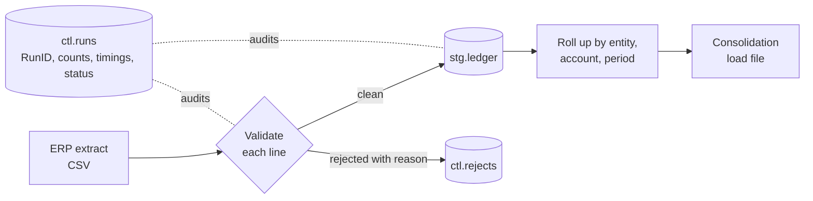

# ledger-pipeline

[](https://github.com/rubenoliveros/ledger-pipeline/actions/workflows/ci.yml)

## Read this first

I built this project with AI assistance, mainly Claude. Did I read every line of code? Between you and me: you got me, I skimmed some of it. What I did read, every time, was each function, closely enough to know what it does and what it should do. Then I reviewed the change and ran it.

If you are hiring, this is the way of working you should be looking for. Your team will not write code from memory, recall every piece of syntax or search Stack Overflow for snippets to adapt to the project. It will work with an AI assistant and its harness every day. What matters is knowing what to ask for, catching what is wrong and owning the result.

This is how I worked here:

* The original project was built for a client, and this repo is not that delivery. Client work usually comes with NDAs and compliance rules like HIPAA or SOC 2, and I take those seriously: no client code, data or names are in here. This repo shows what I did there, rebuilt with synthetic data and not necessarily with the same tools.
* I made the decisions: architecture, data model, trade-offs and what to test.
* Claude helped me write code, tests and documentation faster.
* I reviewed every change, ran the tests and checked the results against what I expected.

I worked in an AI-assisted software development lifecycle, or AI-SDLC: AI takes part in every step, from planning to code, tests and documentation, and a person steers and owns each decision. That is how good teams work now: hand in hand with AI, without leaving everything to it and without refusing to use it out of habit.

## What it is

I built this pipeline to load ledger data from an ERP into a consolidation system, with every line validated, audited and loaded exactly once.

It is very similar to a pipeline I built for production, which moves SAP ledger data into Oracle FCCS/HFM. The architecture and the design decisions are the same; the data and the names are synthetic.

## Why it matters

A financial close depends on three things: every ledger line loads once, someone can prove it, and the load is fast enough to rerun when something changes upstream.

In production, this pattern loads about 170,000 transactions a month. Moving from row by row inserts to batch loading cut the load from 15 minutes to 42 seconds.

This repo reproduces that pattern so anyone can run it, test it and measure it.

## Run it

```bash
git clone https://github.com/rubenoliveros/ledger-pipeline.git && cd ledger-pipeline
uv sync
uv run ledger generate --rows 170000
uv run ledger run data/ledger_extract.csv
uv run ledger export
uv run pytest
```

`generate` writes a synthetic ERP extract with about 0.3% known errors. `run` validates it and loads it, with an audit record. `export` writes the consolidation load file to `out/`.

SQLite is the default database, so nothing else needs to be installed. To use SQL Server:

```bash
cp .env.example .env
docker compose up -d
uv sync --extra mssql
uv run ledger run data/ledger_extract.csv --db mssql:// --method fast
```

Set a strong password in `.env` before starting the container.

## How it works



* **Two schemas, two jobs.** `stg.*` holds the data and `ctl.*` holds the evidence. Each run writes one row to `ctl.runs` with the file hash, load method, row counts, timings, status and any error. Each rejected line goes to `ctl.rejects` with its reason and the original text.
* **Nothing disappears.** In every run, rows read equal rows loaded plus rows rejected. The tests check it.
* **Reruns are safe.** The business key is company, fiscal year, document and line, and it is the primary key, so a line cannot load twice. Loading the same file again is skipped. A forced rerun replaces what the earlier run loaded; with the batch methods this happens in one transaction, so a failure returns to the last good state.
* **Overlapping files are handled.** Lines already loaded from another file are rejected as `key_already_loaded`, and the rest of the load continues.
* **Rejects say why.** Missing fields, unknown accounts or companies, impossible dates, dates outside the period, malformed amounts and duplicates each have their own reason. The export also counts journal entries that no longer add up to zero, so the fix happens at the source and not in the totals.
* **The load method is a setting.** `row` inserts and commits one line at a time. `batch` inserts 5,000 lines per call and commits once. `fast` uses `fast_executemany` on SQL Server.

## Benchmark

SQLite, the same 170,000 line extract, a fresh database for each method. Source: [docs/benchmark-sqlite.md](docs/benchmark-sqlite.md).

| Method | Rows loaded | Seconds | Rows per second | Speed vs row |
|---|---:|---:|---:|---:|
| row | 169,503 | 196.77 | 861 | 1.0x |
| batch | 169,503 | 0.96 | 176,934 | 205.4x |

SQL Server 2022, a 50,000 line extract, measured in CI. Source: [docs/benchmark-sqlserver.md](docs/benchmark-sqlserver.md).

| Method | Rows loaded | Seconds | Rows per second | Speed vs row |
|---|---:|---:|---:|---:|
| row | 49,850 | 21.96 | 2,270 | 1.0x |
| batch | 49,850 | 6.08 | 8,202 | 3.6x |
| fast | 49,850 | 1.18 | 42,103 | 18.6x |

In CI the database runs on the same machine as the pipeline. Over a real network every round trip costs milliseconds, so the gap for row by row grows much wider.

Every CI run repeats this benchmark and publishes the table in the run summary. To run it yourself:

```bash
uv run ledger benchmark data/ledger_extract.csv
```

## Project layout

```
src/ledger/
  generate.py   synthetic extract with balanced journal entries and known errors
  validate.py   line checks, typed rows, reject reasons
  schema.py     stg and ctl tables for SQLite and SQL Server
  pipeline.py   audited load with safe reruns
  export.py     consolidation roll-up and balance check
  benchmark.py  load method comparison
tests/          generator, validation, row accounting, reruns, rollback, export
```

## What comes next

The full plan is in [PLAN.md](PLAN.md). These are the next steps:

* **SAP side.** A realistic FAGLL03 style export, with the header blocks, subtotals and number formats the real file has, and a parser that cleans it.
* **Oracle side.** A mock FCCS service that follows the real REST flow: upload the file, run the integration, check the job status and report rejected lines. A reconciliation compares the SQL totals with the loaded totals.
* **Classification with review.** SQL rules classify most lines. The rest go to Azure OpenAI, which picks from a fixed list of classes and gives a reason. A person approves or corrects each suggestion, and the audit log measures accuracy.
* **Azure.** The same flow deployed on Azure free offers, with Power BI and web dashboards.

## License

MIT
